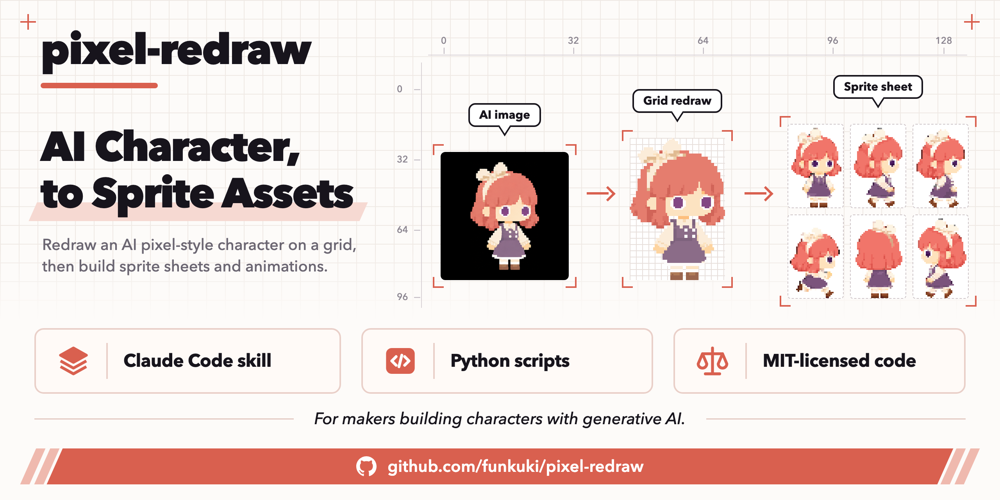
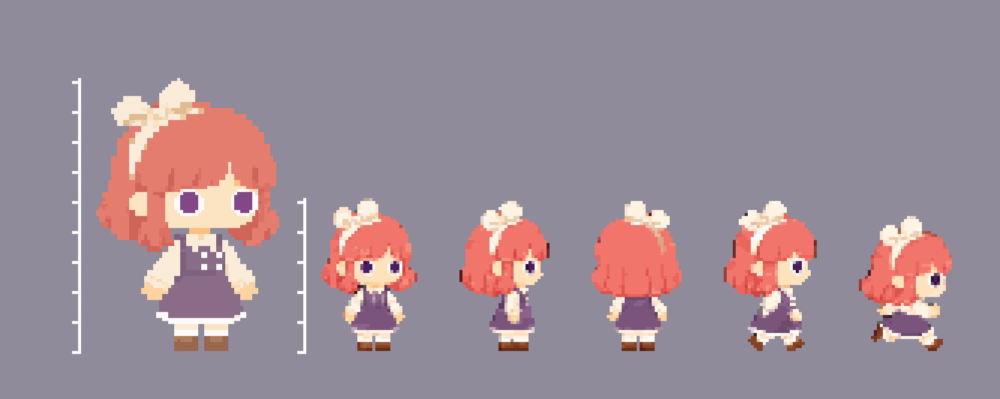
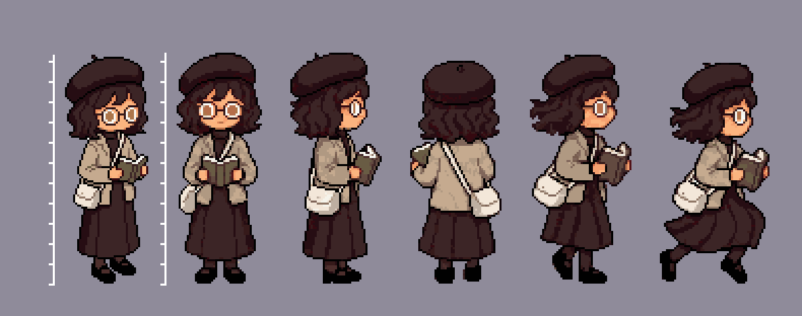
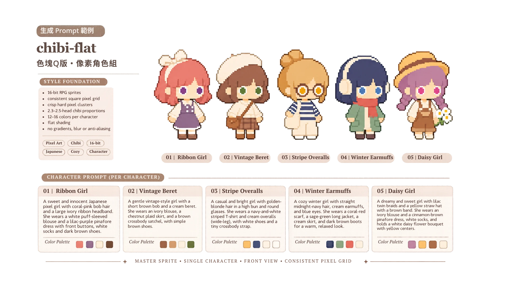
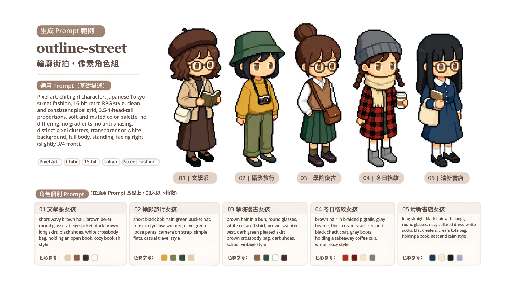
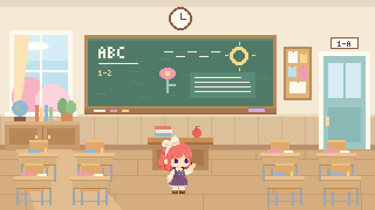
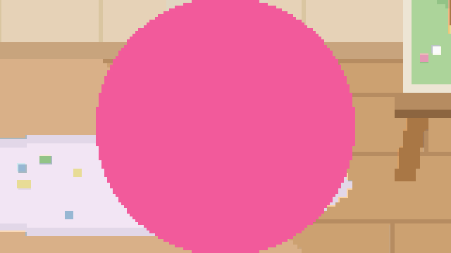
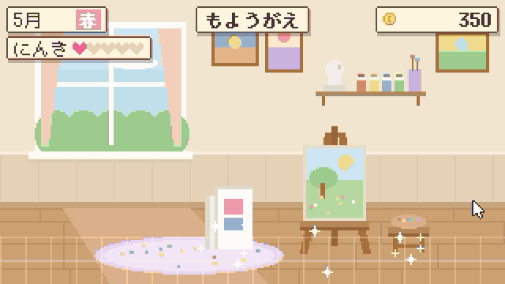

<p align="center">
  
</p>

<p align="center">English | <a href="README.zh-TW.md">繁體中文</a></p>

# pixel-redraw

Redraw AI-generated "pixel-style" characters on a real grid into clean, grid-aligned pixel art, then assemble them into ready-to-use sprite sheets and animations. This is a Skill for [Claude Code](https://claude.com/claude-code).

AI-generated pixel images look like pixel art, but once you zoom in the pixels vary in size, the edges are blurry, there are too many colors, and the character is hard to keep consistent from one image to the next. For indie game developers who make characters with generative AI, this is a very practical pain point.

pixel-redraw treats the AI image only as a reference for the look. It finds the image's grid with code and decides one color for each cell, giving you an image with one color per cell and a small palette. This is closer to a real digital production workflow than to a one-step AI image conversion: the value it tries to offer is how to turn a single AI character image into a set of character assets you can keep using.

> The skill's own instructions (`SKILL.md`, `references/`) are written in Traditional Chinese. Claude reads them and can talk to you in any language.

## Workflow

| Step | What happens | Output |
|---|---|---|
| 1 Idea | Decide the style, the character design and the actions you need | Draft config, prompts |
| 2 Generate the portrait | An image model generates a front-facing standing portrait | AI source image |
| 3 Generate the sprite sheets | With the portrait as reference, generate sheets with a fixed layout | AI sheets |
| 4 Redraw | Redraw the portrait and the sheets on the grid | 1-pixel-per-cell PNGs, frames, JSON |
| 5 Build animations | Arrange frames into actions, set timing, mirror | Sprite sheet, JSON, GIFs, preview page |

After steps 2, 3 and 4, Claude stops and shows you the result, and continues only after you confirm. If you already have AI images, you can start from step 4.

## Two preset styles

**chibi-flat**: big head, short body, no outlines. The portrait is about 90 cells tall; the sprites in the sheets are about 50 cells tall.



**outline-street**: a dark outline around every shape, with more detail. Both the portrait and the sprites are about 115 cells tall.



Each tick on the white ruler is 10 cells. The specs for both styles, and how to choose, are in [references/styles.md](references/styles.md). Other styles work too.

## Prompt examples

These two sheets show how the characters behind each preset style were described to the image model: a shared style description, then a short description and a few palette colors per character. Use them as a model for writing your own character descriptions. The sheets themselves are AI-generated images, not redrawn pixel art.

**chibi-flat**



**outline-street**



The full prompt templates are in [references/prompts.md](references/prompts.md).

## Install

You need Claude Code and Python 3.

Put this folder in Claude Code's skills folder, named `pixel-redraw`:

```bash
git clone https://github.com/funkuki/pixel-redraw.git ~/.claude/skills/pixel-redraw
```

The Python packages (numpy, Pillow, scipy) go in your own virtual environment. Claude creates one the first time you use the skill, or you can create it yourself:

```bash
python3 -m venv .venv && .venv/bin/pip install -r ~/.claude/skills/pixel-redraw/requirements.txt
```

## Usage

Tell Claude Code what you want to make, for example:

- "Use pixel-redraw to make a new pixel character."
- "This AI-generated pixel image has an uneven grid. Clean it up into real pixel art."
- "Cut this sprite sheet into frames and make a walk animation."

Claude first asks about the style, the character design and the actions you need, then works through the steps one at a time.

Each character has its own working folder:

```
my_character/
  character.json     config file
  source/            AI source images, read-only
  work/              prompts, reference images, check images
  out/               results
```

Section boxes, frame names, cells to fix and the animation list all go in `character.json`; you don't edit the scripts. The format is described in [references/config.md](references/config.md), and there are examples in [examples/](examples/).

## Image generation and cost

There are two ways to get the images for steps 2 and 3, with the same result:

- **Manual**: Claude gives you the prompt and the reference image. You generate the image on the ChatGPT or Gemini website and download it. No API key needed.
- **API**: Claude runs `scripts/generate_image.py`. The key is read only from the environment variable `OPENAI_API_KEY` or `GEMINI_API_KEY`, and is never written to a file.

If you use the API:

- API usage is billed separately from a ChatGPT or Gemini subscription.
- Before every call, Claude tells you how many images it will generate and with which model, and runs only after you agree.
- Claude does not regenerate automatically when a result is unsatisfying. You decide whether to generate again.

Attach a style reference image when generating the portrait (`assets/ref_chibi_flat.png` or `assets/ref_outline_street.png`). With a text prompt alone, the proportions and the cell size drift far from the chosen style. Prompt templates are in [references/prompts.md](references/prompts.md).

## Pixel rules

These apply at every step:

- **One color per cell**: no gradients, anti-aliasing or semi-transparent edges.
- **Scale only with nearest-neighbor at integer factors**: in CSS, use `image-rendering: pixelated`.
- **One pixel scale per image**: characters, scenes and effects all use pixels of the same size.
- **No upscalers**: to get a clearer character, redraw it with more cells.
- **Reuse the existing palette**: new images of a character use the colors she already has.
- **Check at 4–10× next to the source image**: eyes, hands and feet go wrong most often.

## Output

| File | Content |
|---|---|
| `NAME_1x.png`, `NAME_10x.png` | Portrait: the 1-pixel-per-cell original and a 10× version |
| `NAME_sheet.png`, `NAME_sheet_4x.png` | Sprite sheet and a 4× version |
| `NAME_sheet.json` | Frame positions, animations, timing, anchor, palette |
| `frames/`, `gif/` | Single-frame PNGs and one GIF per animation |
| `NAME_preview.html` | A single-file preview page; open it in a browser to play every animation |

The anchor's x is the center of the head and its y is the ground line under the feet. To place a character in a scene, put the anchor on the standing position.

## What you can make with the output

The sprite sheet, JSON and anchor are plain files, so the characters drop straight into scenes, videos and games. The examples below were made with Claude Code from characters produced by this workflow. The brand and the game in them are fictional.

**Scenes.** A 320×180 scene drawn at the same pixel scale as the character, so the sprite goes in at 1:1. The anchor sits on the standing position, and furniture layers are sorted by their y so the character can walk behind a desk.



**Animation and video.** A 33-second ad for a fictional contact-lens brand, built in the browser with three.js at a native 320×180 and scaled up by integer factors. It uses the walk and run cycles, actions, expressions and the large portraits.



**Games.** A promo video for a fictional shop-management game, with a game HUD, customers, speech bubbles and placement cursor. The five girls are played from their sprite sheets and JSON, which hold what a game engine needs: frame rectangles, per-animation timing, and the anchor for positioning.



## What's in this folder

| Path | Content |
|---|---|
| `SKILL.md` | The workflow instructions Claude reads |
| `scripts/redraw_portrait.py` | Redraws the portrait |
| `scripts/redraw_sheet.py` | Cuts out and redraws each sprite in a sheet |
| `scripts/build_animation.py` | Arranges animations and writes the sheet, JSON, GIFs and preview page |
| `scripts/make_scale_ref.py` | Makes the scale reference image used to generate sheets |
| `scripts/generate_image.py` | Calls an image API (optional) |
| `scripts/compare.py`, `scripts/inspect_cells.py` | Zoomed comparison; viewing and fixing individual cells |
| `scripts/pxlib.py` | Shared functions |
| `references/` | Config format, prompt templates, styles, image generation notes |
| `examples/` | Example config files |
| `assets/` | Style diagrams, style reference images, banner, prompt sheets, README examples |

## Known limits

- Eyes, hands and feet usually need manual cell-by-cell fixes after the automatic pass. The workflow includes tools for this.
- On white-background sheets with white clothing, the background between the legs and stray cells outside the outline have to be cleaned by hand.
- outline-street sheets need an image model that can output 4K.
- The skill ends at the sprite sheet and its animations. Scenes, videos and games like the examples above are built in separate Claude Code sessions that read these files; the skill does not generate them.

## License

The scripts and documentation are released under the [MIT License](LICENSE).

The images in `assets/` (character art, banner, style diagrams, video clips) are not covered by it and remain all rights reserved. You may use the two `ref_*.png` files as style references when making your own characters with this skill. See [assets/LICENSE.md](assets/LICENSE.md).
