<p align="center">
  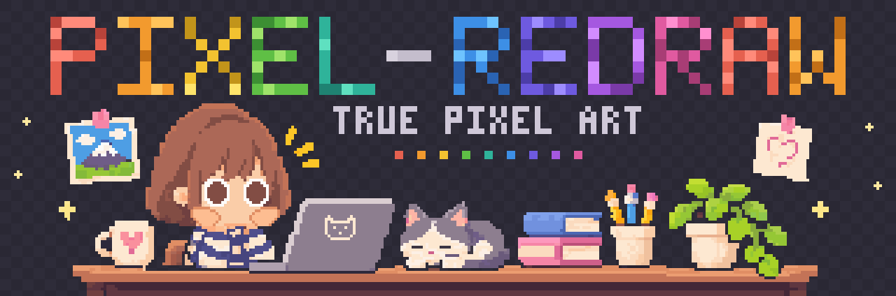
</p>

<p align="center"><a href="README.md">English</a> | 繁體中文</p>

# pixel-redraw

把影像模型畫的「像素風」角色，依網格重繪成真正的像素圖，再排成可以直接用的精靈圖表和動畫。這是一個 [Claude Code](https://claude.com/claude-code) 的 Skill。

AI 生成的像素圖看起來像 Pixel Art，但放大後像素大小不一、邊緣模糊、色彩過多，角色也難以保持一致。對使用生成式 AI 製作角色的獨立遊戲開發者而言，這是很實際的痛點。

pixel-redraw 把 AI 圖只當成外觀的參考，用程式找出它的網格，每一格重新決定一個顏色，得到一格一色、小色盤的圖。它比單純的 AI 圖像轉換更接近實際的數位創作流程，試圖提供的價值是「如何讓一張 AI 角色圖變成一套能持續使用的角色資產」。

## 流程

| 步驟 | 做什麼 | 產出 |
|---|---|---|
| 1 想法 | 決定風格、角色設定、要哪些動作 | 設定檔草稿、提示詞 |
| 2 生成角色圖 | 影像模型生成正面站姿的立繪 | AI 原圖 |
| 3 生成精靈圖表 | 拿立繪當參考，生成固定版面的圖表 | AI 圖表 |
| 4 重新繪製 | 立繪和圖表都依網格重繪 | 一格一像素的 PNG、畫格、JSON |
| 5 建立動態 | 排成動作、設定速度、鏡射 | 精靈圖表、JSON、GIF、預覽頁 |

第 2、3、4 步做完，Claude 都會停下來把結果給你看，確認後才往下做。手上已經有 AI 圖的話，可以直接從第 4 步開始。

## 兩種預設風格

**色塊 Q 版（chibi-flat）**：大頭、短身體，沒有輪廓線。立繪約 90 格高，圖表裡的小人約 50 格高。

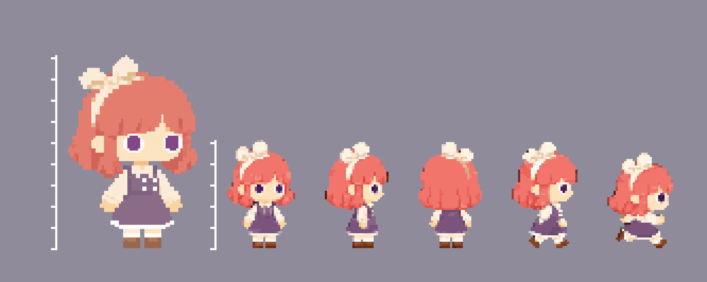

**輪廓街拍（outline-street）**：每個形狀都有深色輪廓線，細節較多。立繪和小人都約 115 格高。

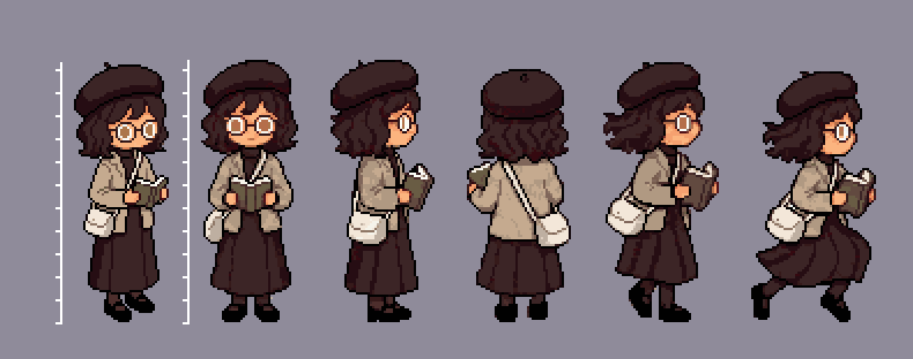

圖裡的白色標尺每一個刻度是 10 格。兩種風格的規格和選法寫在 [references/styles.md](references/styles.md)；其他風格也可以做。

## 提示詞範例

這兩張圖是兩種預設風格的角色當初交給影像模型的描述方式：先有一段共用的風格描述，再替每位角色寫一小段描述和幾個主要顏色。寫自己的角色描述時可以照這個形式。圖本身是 AI 生成的，不是重繪後的像素圖。

**色塊 Q 版**

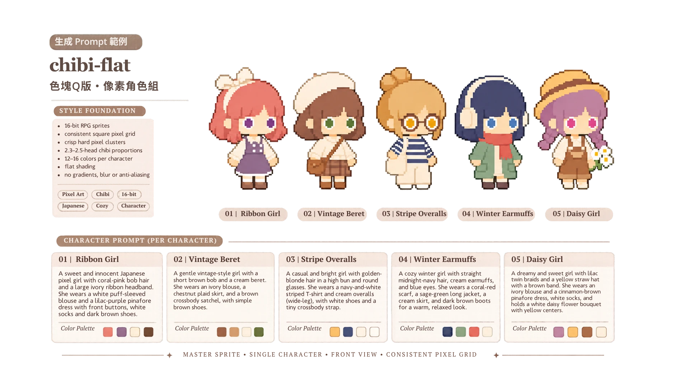

**輪廓街拍**

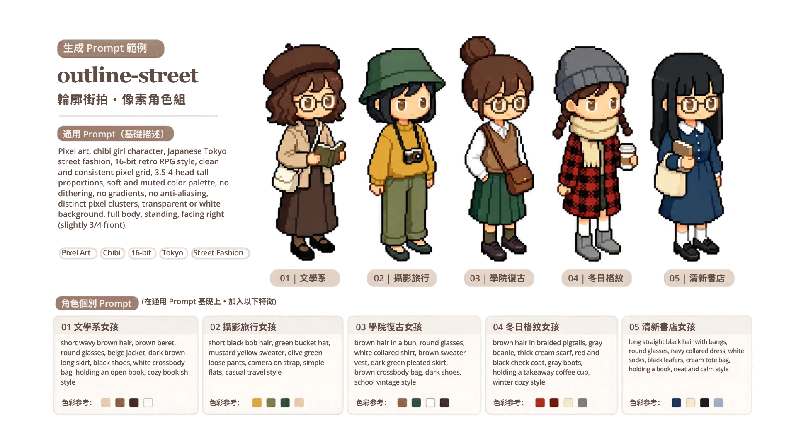

完整的提示詞範本在 [references/prompts.md](references/prompts.md)。

## 安裝

需要 Claude Code 和 Python 3。

把這個資料夾放進 Claude Code 的 skills 資料夾，資料夾名稱用 `pixel-redraw`：

```bash
git clone https://github.com/funkuki/pixel-redraw.git ~/.claude/skills/pixel-redraw
```

Python 套件（numpy、Pillow、scipy）裝在你自己的虛擬環境裡。第一次使用時 Claude 會幫你建，也可以自己先建好：

```bash
python3 -m venv .venv && .venv/bin/pip install -r ~/.claude/skills/pixel-redraw/requirements.txt
```

## 使用

在 Claude Code 裡直接說想做什麼，例如：

- 「用 pixel-redraw 做一個新的像素角色」
- 「這張 AI 生成的像素圖格子不整齊，幫我整理成真正的像素圖」
- 「把這張精靈圖表切成畫格，做成走路動畫」

Claude 會先問風格、角色設定和要哪些動作，再一步一步往下做。

每位角色有一個自己的工作資料夾：

```
my_character/
  character.json     設定檔
  source/            AI 原圖，只讀不改
  work/              提示詞、參考圖、檢查用的圖
  out/               成品
```

切圖範圍、畫格名稱、要修正的格子、動作清單都寫在 `character.json`，腳本本身不用改。格式見 [references/config.md](references/config.md)，範例在 [examples/](examples/)。

## 影像生成和費用

第 2、3 步的圖有兩種取得方式，結果一樣：

- **手動**：Claude 給你提示詞和參照圖，你在 ChatGPT 或 Gemini 的網頁生成後下載。不需要 API 金鑰。
- **API**：Claude 執行 `scripts/generate_image.py`。金鑰只從環境變數 `OPENAI_API_KEY` 或 `GEMINI_API_KEY` 讀取，不會寫進任何檔案。

用 API 時請注意：

- API 照用量另外計費，和 ChatGPT、Gemini 的訂閱是分開的帳單。
- 每次呼叫前，Claude 會先告訴你要生成幾張、用哪個模型，你同意後才執行。
- 結果不滿意時不會自動重做，由你決定要不要再生成一次。

生成立繪時要附上風格參照圖（`assets/ref_chibi_flat.png` 或 `assets/ref_outline_street.png`）。只給文字提示詞，模型畫出來的比例和格子大小會和選定的風格差很遠。提示詞範本在 [references/prompts.md](references/prompts.md)。

## 建議：用 PixelLab 做第 3 步

這一節是實測後的建議，**skill 本身還沒有內建**，目前的流程仍然是上面的 1–5 步。

[PixelLab](https://www.pixellab.ai/) 是專門生成像素圖的服務，輸出本身就是一格一色、沒有半透明，也能指定色盤。我們拿這套流程重繪好的立繪（96×96）和小人（64×64）當參考圖實測：

| 做法 | 每個方向花幾次 | 結果 |
|---|---|---|
| `create-character-v3`，用參考圖轉出四方向 | 1–2 次（四方向合計） | 正面和參考圖完全相同，側面、背面的比例一致 |
| 動畫 `pixminimax`，8 格走路 | 1 次 | 最好：步伐明顯，四個方向都是真的在走，加上 `target_palette` 後顏色都在原色盤裡 |
| 動畫 `skeleton-v3`（骨架） | 3 次 | 維持正面，但步伐很小 |
| 動畫 `v3`（文字） | 3 次 | 會轉成斜側面在走，中間幾格眼睛半閉 |
| 動畫 `template`（骨架範本） | 約 1 次 | 不能指定色盤，臉上有雜點 |
| `pixminimax`，8 格跑步 | 1 次 | 四個方向都有大步伐和頭髮擺動，比原本用站姿做的上下簡化版自然 |
| `pixminimax`，文字描述的自訂動作 | 1 次 | 揮手、喝飲料、看書、拍照、坐下、開心都做得出來；道具會自己畫，顏色仍在色盤內 |

**轉身。** 最左邊是用這套流程重繪的立繪，右邊四張是 PixelLab 轉出的正面、右、背面、左。

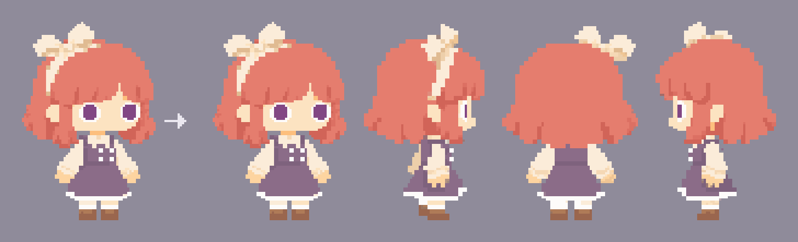

**`pixminimax` 走路。** 最左邊是用這套流程重繪的小人，右邊是 PixelLab 生成的四方向走路，每個方向花 1 次。

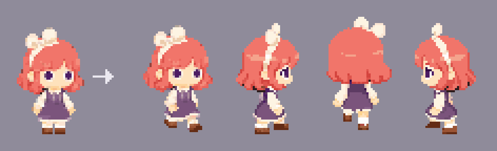

**三種動畫模式比較。** 由左到右是 `v3`、`skeleton-v3`、`pixminimax`，都是立繪尺寸向下走。

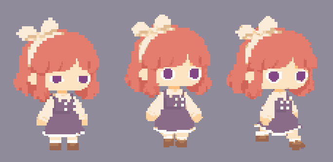

**`pixminimax` 跑步。** 最左邊是用這套流程重繪的小人，右邊是 PixelLab 生成的向下、右、上、左跑步，每個方向花 1 次。

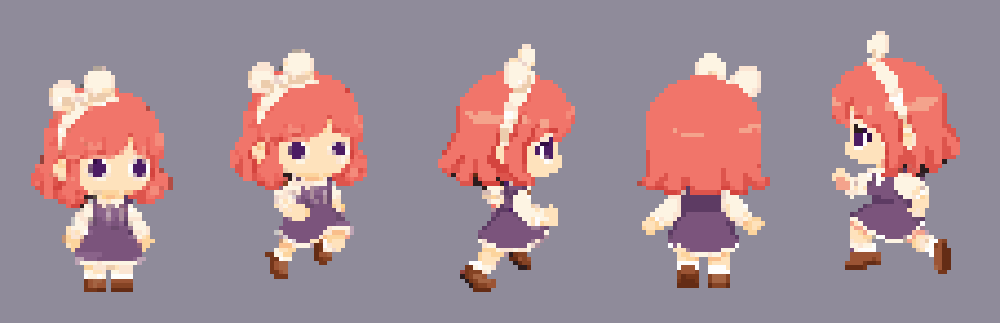

**自訂動作。** 由左到右是揮手、喝飲料、看書、拍照、坐下、開心，都只做正面，每個動作花 1 次，只用一句英文描述動作。道具是 PixelLab 自己畫的，而且會被限定在原色盤裡，所以書是棕色而不是綠色。多數動作做出姿勢後就停住，後半幾格幾乎相同，適合取最後一格當單張動作圖；要做一直循環的動畫就不夠。表情特寫做不出來，動畫只能是全身。

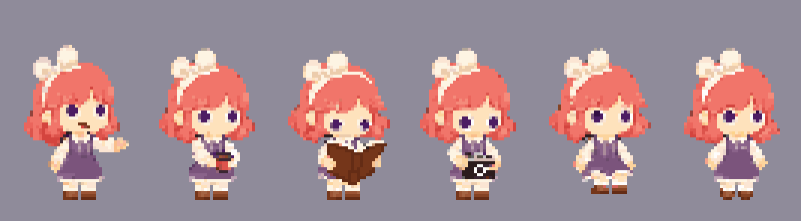

建議的流程是 **1 → 2 → 3 → 4b → 5**：

1. **想法**：照原本的方式。
2. **立繪**：照原本的方式生成，再依網格重繪（第 4 步只做立繪）。
3. **精靈圖表改用 PixelLab**：把重繪好的立繪當參考圖轉出四方向，再用 `pixminimax` 生成每個動作，`target_palette` 填立繪的色盤。不需要鏡射，向上、向下也不再是簡化版。
4. **只做檢查和修正**：畫格不用再找網格和取色，只要確認沒有色盤外的顏色，再逐格放大檢查臉、手、腳。
5. **建立動態**：PixelLab 的畫布大小不同（例如 84×84），角色位置每格會差 1–3 格，要重新對到錨點、統一畫格大小。

費用：PixelLab 免費方案有 40 次，付費方案每月 12 美元 2,000 次。以走路、跑步各四方向加 6 個正面動作計算，一個角色約 16–25 次。

還沒驗證的：用 PixelLab 從文字直接生成立繪、斜側面的立繪能不能當參考圖、立繪尺寸的自訂動作。

## 像素規則

每一步都遵守這幾條：

- **一格一色**：沒有漸層、抗鋸齒、半透明邊緣。
- **只用最近鄰、整數倍放大**：CSS 用 `image-rendering: pixelated`。
- **同一個畫面只有一種像素比例**：角色、場景、特效的像素要一樣大。
- **不用 upscaler**：需要更清楚的角色，要用更多格子重新畫。
- **新圖沿用既有色盤**：同一位角色的新圖用她已有的顏色。
- **做完放大 4–10 倍和原圖並排檢查**：眼睛、手、腳最常出錯。

## 成品

| 檔案 | 內容 |
|---|---|
| `NAME_1x.png`、`NAME_10x.png` | 立繪：一格一像素的原始檔和十倍放大版 |
| `NAME_sheet.png`、`NAME_sheet_4x.png` | 精靈圖表和四倍放大版 |
| `NAME_sheet.json` | 畫格位置、動作、速度、錨點、色盤 |
| `frames/`、`gif/` | 單格 PNG 和每個動作的 GIF |
| `NAME_preview.html` | 單一檔案的預覽頁，用瀏覽器打開就能播放每個動作 |

錨點的 x 是頭部中心，y 是腳底的地面線；把角色放進場景時，把錨點對到站位。

## 成品可以拿來做什麼

精靈圖表、JSON 和錨點都是一般的檔案，角色可以直接放進場景、影片和遊戲。下面的範例都是用這套流程做出的角色，再用 Claude Code 做的；裡面的品牌和遊戲是虛構的。

**場景。** 320×180 的場景，像素比例和角色相同，所以角色以 1:1 直接放進去。錨點對到站位，家具圖層依 y 排序，角色才能走到課桌後面。

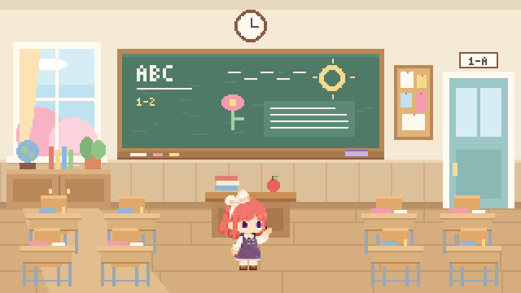

**動畫和影片。** 一支 33 秒的虛構隱形眼鏡品牌廣告，用 three.js 在瀏覽器裡以原生 320×180 製作，再整數倍放大。用到走路、跑步、動作、表情和大立繪。

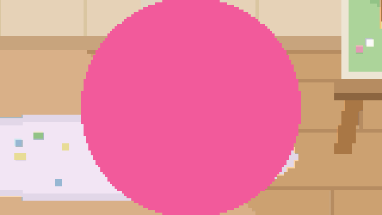

**遊戲。** 一支虛構經營模擬遊戲的宣傳影片，畫面有遊戲介面、客人、對話框和佈置游標。五位女孩都是照各自的精靈圖表和 JSON 播放的，裡面就是遊戲引擎需要的資料：畫格位置、每個動作的速度、對位用的錨點。

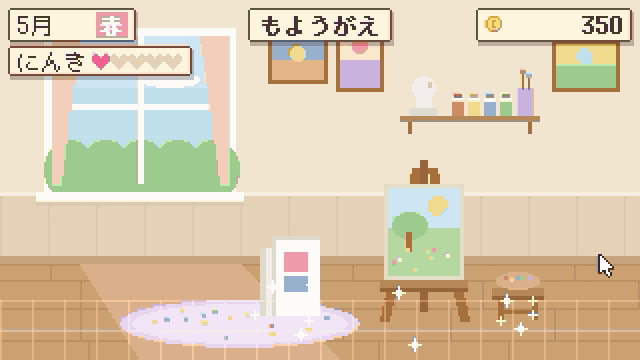

## 資料夾內容

| 路徑 | 內容 |
|---|---|
| `SKILL.md` | Claude 讀的流程說明 |
| `scripts/redraw_portrait.py` | 重繪立繪 |
| `scripts/redraw_sheet.py` | 切出圖表裡的每個小人並重繪 |
| `scripts/build_animation.py` | 排成動作，輸出圖表、JSON、GIF、預覽頁 |
| `scripts/make_scale_ref.py` | 製作生成圖表用的比例參考圖 |
| `scripts/generate_image.py` | 呼叫影像 API（選用） |
| `scripts/compare.py`、`scripts/inspect_cells.py` | 放大對照、查看和指定格子 |
| `scripts/pxlib.py` | 共用的函式 |
| `references/` | 設定檔格式、提示詞範本、風格、影像生成說明 |
| `examples/` | 設定檔範例 |
| `assets/` | 風格圖解、風格參照圖、banner、提示詞表、README 的範例圖 |

## 已知的限制

- 自動結果在眼睛、手、腳通常需要指定格子人工修正，流程裡有對應的工具。
- 白底圖表加上白色衣物時，兩腿之間的背景和輪廓外的殘影要手動清。
- 輪廓街拍的圖表需要能輸出 4K 的影像模型。
- 這個 skill 做到精靈圖表和動態為止。上面範例那樣的場景、影片和遊戲，是另外用 Claude Code 讀取這些檔案做出來的，skill 本身不會產生。

## 授權

腳本和文件以 [MIT License](LICENSE) 釋出。

`assets/` 裡的圖（角色圖、banner、風格圖解、影片片段）不適用 MIT，保留所有權利。使用這個 skill 製作自己的角色時，可以把兩張 `ref_*.png` 當成風格參照圖。詳見 [assets/LICENSE.md](assets/LICENSE.md)。
