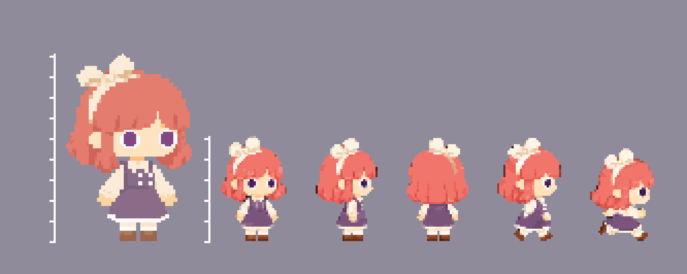
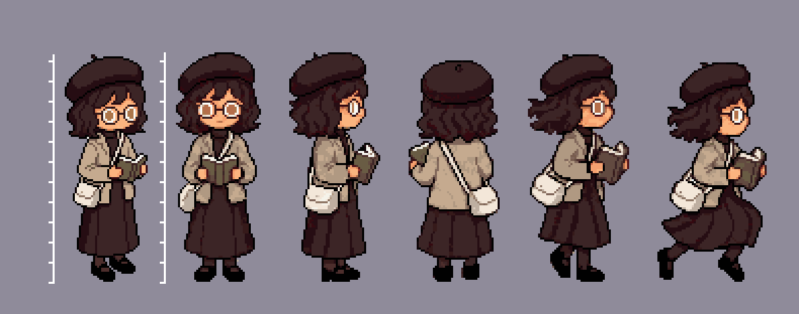

# 兩種預設風格

第 1 步問使用者風格時，用下面的名稱和圖解來問。圖解在 `assets/`，問之前先把兩張圖給使用者看（用 Read 打開，或告訴他檔案位置），不要只用文字形容，也不要用「和某某作品同一路線」這種要先認識別的作品才聽得懂的說法。

兩種之外的風格也可以做；這兩種是實際做過、參數已經試出來的。使用者要別的風格時，照同一張表把每一項問清楚。

圖解的看法：最左邊是立繪，右邊依序是圖表裡的正面、側面、背面、走路、跑步。白色標尺每一個刻度是 10 格。全部都是同一個放大倍率，所以大小的差別就是格數的差別。

## 色塊 Q 版（chibi-flat）



大頭、短身體，沒有輪廓線，形狀只靠色塊和同色系深一階的陰影分開。可愛、柔和，適合放在小場景裡走動的角色。

| 項目 | 數值 |
|---|---|
| 頭身比 | 約 2–2.5 頭身，頭佔全高約 40–45% |
| 視角 | 立繪正面；圖表有正面、側面、背面 |
| 輪廓線 | 沒有 |
| 立繪高度 | 約 90 格 |
| 圖表小人高度 | 約 50 格（立繪和小人是兩種解析度，小人的細節比立繪少） |
| 畫格／錨點 | 64×64，錨點 `[32, 62]` |
| 色數 | 立繪約 16 色；圖表約 45–65 色 |
| 眼睛 | 深色單色橢圓加白邊，沒有瞳孔和高光 |
| 生成用的背景 | 純黑（角色身上不能有黑色），去背用 `"remove_background": "all"` |
| 圖表尺寸 | 1536×1024 就夠（50 格高的小人大約 3 px 一格） |
| 立繪的風格參照圖 | `assets/ref_chibi_flat.png`（生成立繪時一定要附） |

立繪用 prompts.md 裡「色塊 Q 版的範本」整份提示詞加參照圖。圖表提示詞的 STYLE 行：

```
STYLE: cute chibi proportions, about 2.5 heads tall, the head is about 40% of the total height. NO dark outline around shapes: shapes are separated only by flat color areas and a slightly darker shade of the same color. Soft, warm palette.
```

要注意：沒有輪廓線，所以淺色的衣服和膚色相鄰時容易糊在一起，配色要讓相鄰的色塊明暗有差。小人只有 50 格高，眼鏡、手指這類細節畫不出來，設計角色時配件要大而簡單。

## 輪廓街拍（outline-street）



比例比較接近真人，每個形狀都有深色輪廓線，衣服有皺褶和明暗。細節多，適合特寫、展示穿搭和配件。

| 項目 | 數值 |
|---|---|
| 頭身比 | 約 3.5–4 頭身，頭佔全高約 28–30% |
| 視角 | 立繪是斜側面（三分之四）站姿；圖表有正面、斜側、側面、背面 |
| 輪廓線 | 有，深色（接近黑的深棕） |
| 立繪高度 | 約 110–120 格 |
| 圖表小人高度 | 和立繪一樣，約 115 格 |
| 畫格／錨點 | 112×144，錨點 `[56, 140]` |
| 色數 | 約 30–40 色 |
| 眼睛 | 淺棕色單色方塊加白邊；閉眼是一條短線 |
| 生成用的背景 | 純白，去背用 `"remove_background": "border"`；圖表用 `"enclosed": "keep"` 加 `trim_fringe` |
| 圖表尺寸 | 要 4K（約 5504×3072），每張 2 列 × 6 格，一格約 11 px。尺寸不夠大就放不下 115 格高的小人 |
| 立繪的風格參照圖 | `assets/ref_outline_street.png`（生成立繪時一定要附） |

立繪用 prompts.md 裡「輪廓街拍的範本」整份提示詞加參照圖。圖表提示詞的 STYLE 行：

```
STYLE: semi-realistic proportions, about 3.5 to 4 heads tall. A dark outline around every shape. Clothing has folds and two or three shades per color. Muted, natural street-fashion palette.
```

要注意：圖表要夠大，所以影像模型要能輸出 4K；只能輸出 1536×1024 的模型做不了這個風格的 12 格圖表（每張只能放約 4 個小人）。白底加白色衣物（白襪、白襯衫）時，兩腿之間的背景和輪廓外的殘影要手動修，比色塊 Q 版費工。

## 怎麼選

| 需求 | 建議 |
|---|---|
| 放進小場景、遊戲裡走動，角色多 | 色塊 Q 版 |
| 特寫、穿搭、配件細節 | 輪廓街拍 |
| 影像模型只能輸出 1536×1024 以下 | 色塊 Q 版 |
| 想少做人工修正 | 色塊 Q 版 |

同一個畫面只能有一種風格和一種像素比例；兩種風格的角色不要放在一起。
